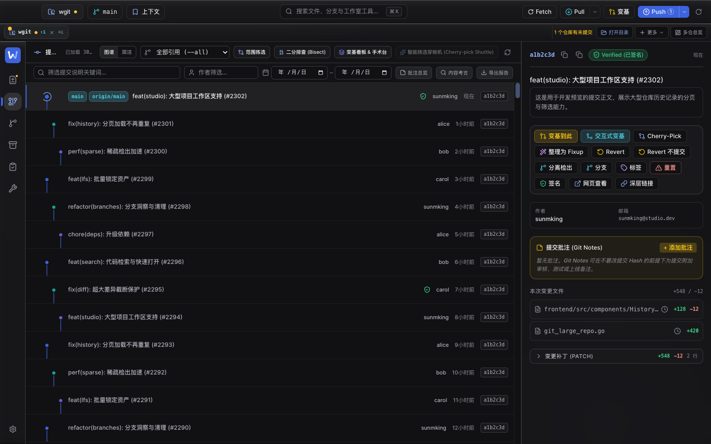
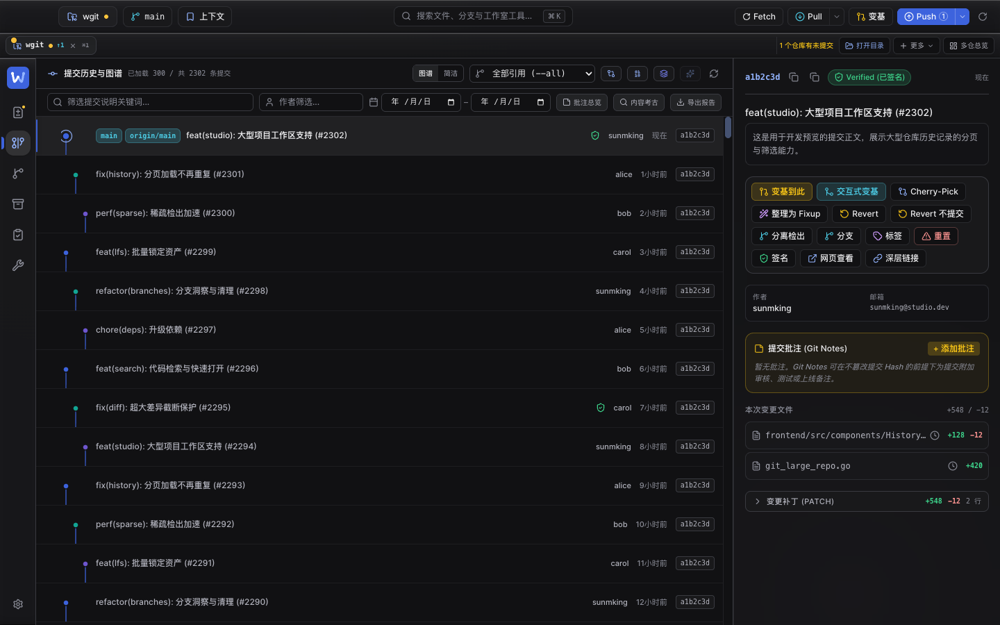
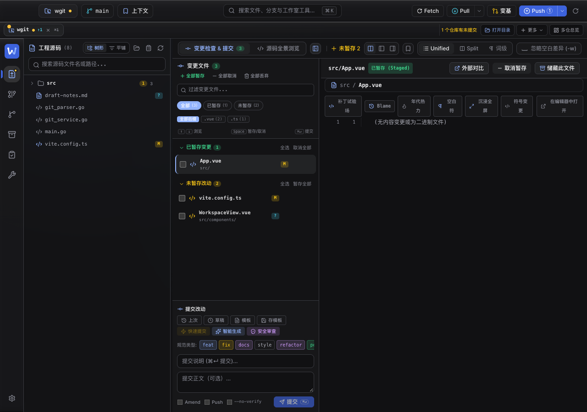
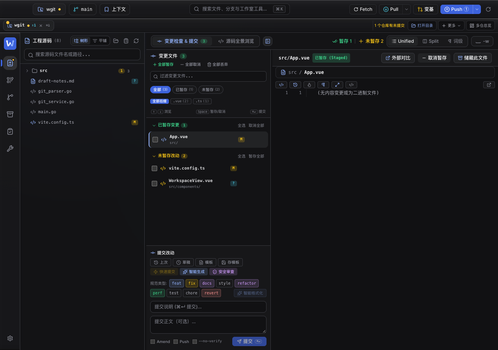
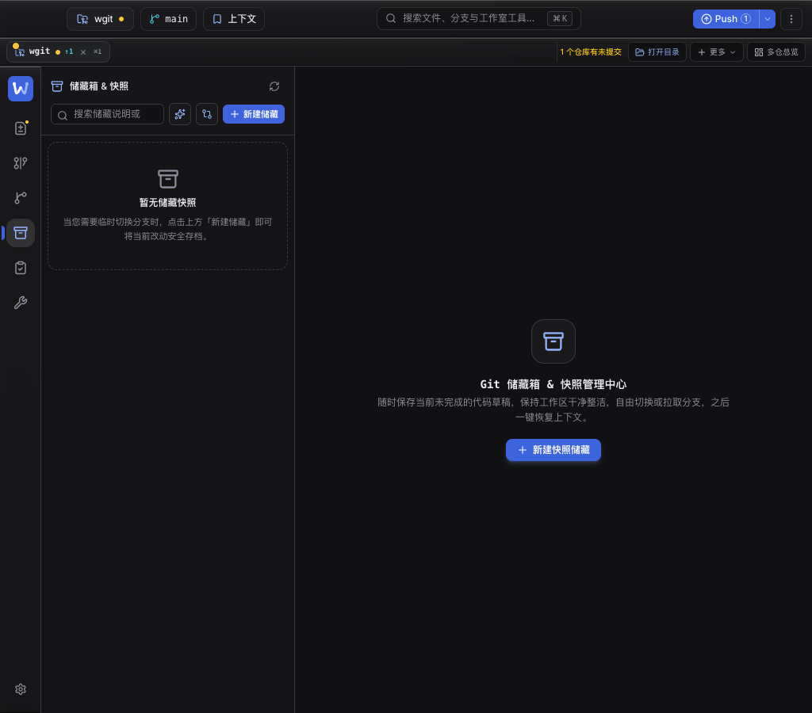
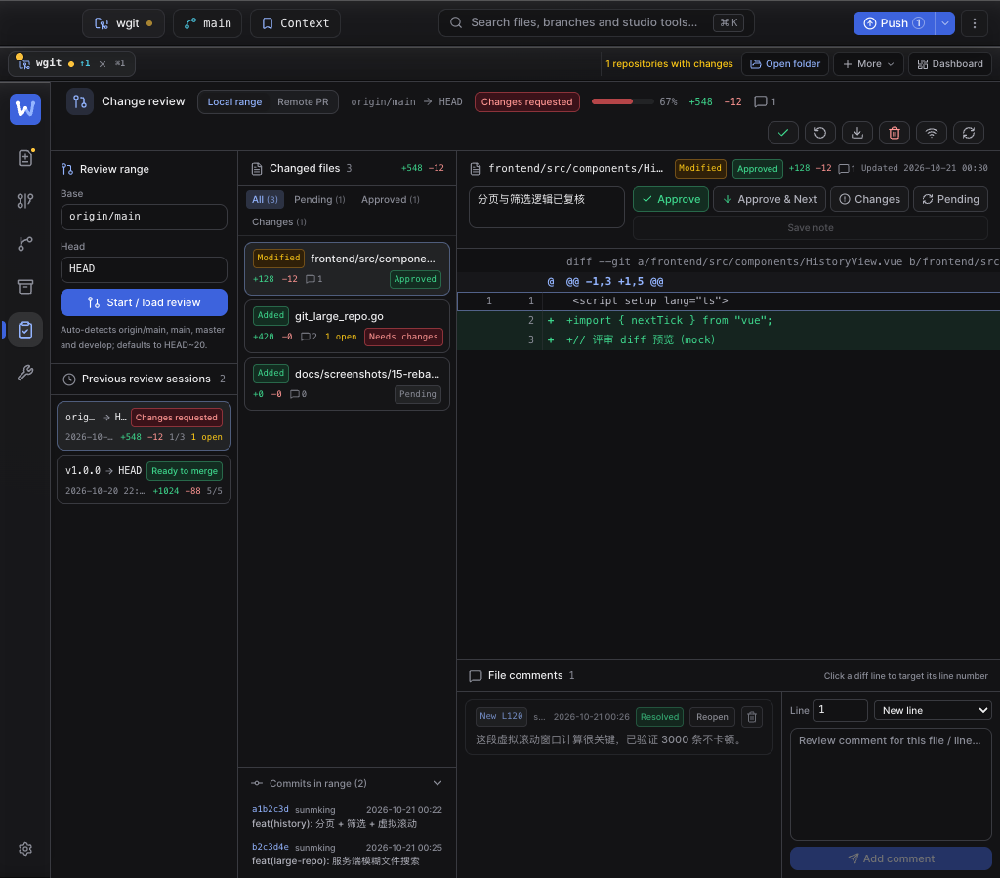
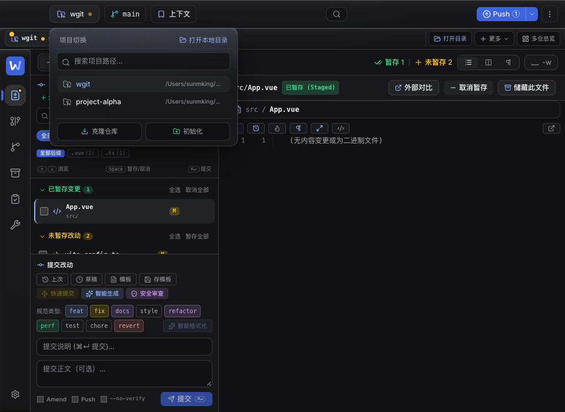
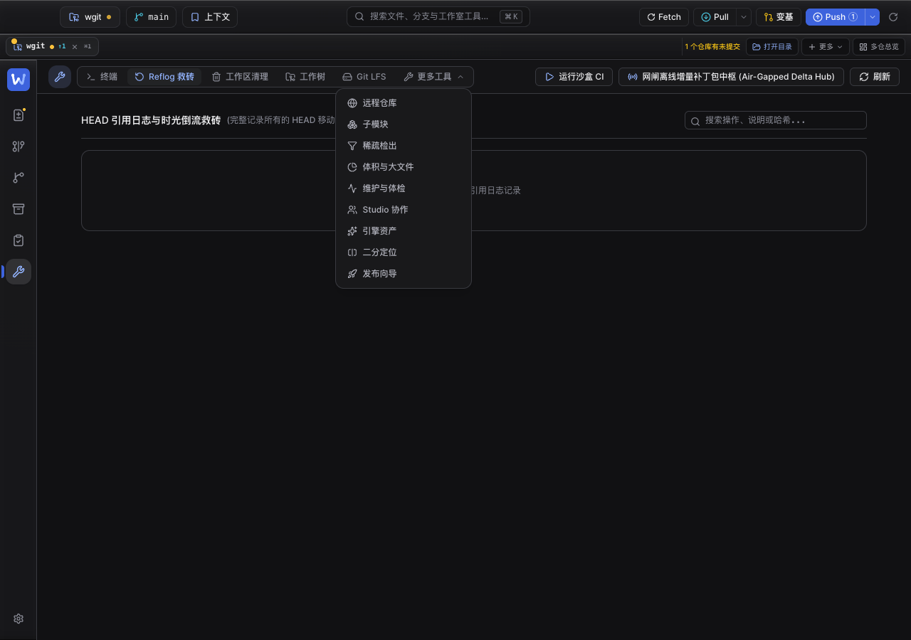

# 全局 UI 布局审查与修复（2026-10-30）

> 范围：应用外壳 + 7 个主视图 + 工具页 14 个子 Tab + 设置页 11 个分区 + 顶栏下拉与主要弹窗。目标是把「窗口还能显示，但控件已经放不下 / 弹层被裁掉」这一类布局问题清掉，并留下可回归的守卫。
>
> 方法：Vite 预览（dev fixtures 代替 Wails 后端）+ Playwright，在 **960 / 1024 / 1280 / 1440 / 1920** 五个宽度逐视图截图，并对 DOM 做三类测量：
>
> 1. `scrollWidth > clientWidth` 且 `overflow-x: hidden` 的文字/按钮（被裁切）；
> 2. `getBoundingClientRect().right > viewport` 的元素（跑出窗口）；
> 3. 按钮高度 > 1.9 倍行高（标签折行成两行）。
>
> 关键教训：**窗口宽度 ≠ 控件可用宽度**。工作区打开源码树时右栏只有 ~560px，历史页打开检查器后提交列只有 ~950px，储藏箱侧栏固定 320px。这三处的旧实现都用了 `lg:` / `xl:` 视口断点，于是窗口越宽反而越挤。

## 截图对照

| 修复前 | 修复后 |
| --- | --- |
|  |  |
|  |  |

| 储藏箱两行头部（1024） | 评审头部英文图标态（1024） |
| --- | --- |
|  |  |

## 问题与修复

| # | 位置 | 现象（实测） | 根因 | 修复 |
| --- | --- | --- | --- | --- |
| 1 | `workspace/DiffViewer.vue` 差异工具条 | 1280 窗口 + 源码树展开时，pane 仅 557px；按钮折成 **46px 高两行**，「补丁试验 / 场」「沉浸全 / 屏」逐字断行 | 标签无 `whitespace-nowrap`，且按视口断点决定显隐 | 工具条设为 `@container`；< 640px 容器隐藏文字只留图标（保留 `title` + 新增 `aria-label`）；剩余空间不足时整组换行 |
| 2 | `WorkspaceView.vue` 顶栏操作区 | 1280/1440 下「暂存 1」被画到标签切换条下面（实测元素 x=653，容器 x=708），鼠标不可达 | `justify-end` + `overflow-x-auto` 的经典反向溢出：内容超宽时向左溢出，起始控件不可滚动到 | 外层只负责滚动，内层 `w-max min-w-full` 让滚动内容从第一个控件开始；计数/布局预设改由 `@container`（700 / 940px）决定显隐 |
| 3 | `HistoryView.vue` 时间线头部 | **1440 窗口**下标题被压成 32px（「提…」），计数被裁成 57/148，头部整体横向溢出 21px | 提交列实际 ~950px，但标签用 `xl:`（≥1280 视口）判定 | 头部 `@container`：计数 ≥760、拓扑统计 ≥900、遍历工具 ≥900（图标）、标签 ≥1400；分支选择框最大宽度同步改容器查询 |
| 4 | `HistoryFilterBar.vue` | 1280 下「导出报告」单独掉到第二行，左侧空一大片 | 次要动作是输入框的兄弟节点，换行后各自落位 | 三个次要动作收进 `ml-auto` 右对齐组，换行时整组换行 |
| 5 | `StashView.vue` 侧栏头部 | 320px 侧栏里标题折成「储藏箱 & / 快照」，三个按钮高 43px，刷新图标贴到分隔线 | 单行塞入标题 + 计数 + 4 个带文字动作 | 改两行：第一行标题/计数 + 刷新/清空（图标）；第二行搜索 + 微快照/对比（图标）+ 新建储藏（唯一主按钮） |
| 6 | `ReviewView.vue` 头部 | 1024 窗口下操作区超出右边界约 150px，「局域网评审」被裁掉 | 6 个带文字动作 + 会话摘要总和 ~1060px，单行 `h-12` 且无换行 | 头部 `@container` + `flex-wrap` + `min-h-12`；< 1100px 容器动作只留图标（`aria-label` 保留），极窄时整组换行 |
| 7 | `workspace/CommitComposer.vue` | 「perf」类型胶囊被裁成「pe」，且没有可见滚动条 | `overflow-x-auto no-scrollbar` | 改为 `flex-wrap`，类型胶囊最多两行 |
| 8 | `workspace/ChangesList.vue` | 状态/后缀筛选胶囊藏在无滚动条的横向滚动区里；选中胶囊对比度 2.06（深色）/ 2.73（浅色琥珀）不达 AA | `no-scrollbar` 横向滚动；选中态用 `bg-accent` + 浅色 accent | 两组筛选改 `flex-wrap`（后缀最多 8 个，最多两行）；选中态改 `bg-accent-strong text-accent-contrast` |
| 9 | `ToolsView.vue` 子导航 | 1024 窗口下「工作树 (」被切断，「Git LFS」「更多工具」滚出可视区且无提示 | 5 个带文字主 Tab + 右侧动作超出头部 | 主 Tab 标签 `<xl` 折叠为图标（保留 `title`/`aria-label`），五个 Tab + 更多在任何受支持宽度都完整可见 |
| 10 | `BranchesView.vue` / `ToolsView.vue` 滚动区 | 宽度上限放在滚动容器上：1920 下滚动条落在屏幕中间（1440/1872 处）；分支页工具条贴窗口边而列表居中 | `max-w-*` + `overflow-y-auto` 写在同一元素 | 滚动容器全宽、宽度上限移到内层（与 SettingsView 既有写法一致）；分支页头部与列表共用同一个 `max-w-5xl` 列 |
| 11 | `settings/AppearanceSection.vue` | 「高对比度 / 降低透明度」说明被 `truncate` 截断成一行的「…」 | 单行省略 | `line-clamp-2`，说明最多两行完整可读 |
| 12 | `review/SessionList.vue` 历史评审卡片 | 1024 下 190px 卡片里判词胶囊与会话范围同行，`origin/main → HEAD` 被压缩成「orig… → H…」 | 判词占宽约 100px，范围只剩 ~80px | 判词移入第二行元数据区并允许整行换行，范围独占首行 |
| 13 | `review/ChangeList.vue` 文件筛选胶囊 | 列宽 224px，四个胶囊被 flex 压缩成「标签 / (计数)」两行，长语言下更挤 | 横向滚动行 + 默认可收缩 | 改 `flex-wrap`，胶囊 `whitespace-nowrap shrink-0`，整枚换行 |

### 英文界面复核

上述结论先在中文界面验证，再用 `en-US` 在同样 5 个宽度复核。英文比中文平均长 30–40%，额外发现三处并已修复：

- 工作区「忽略空白差异 (-w)」在 1280/1440 超出 560px 操作区（按钮右边界 1330/1446 > 窗口宽），导致它被 `overflow-hidden` 裁掉且无法点击。改为容器 ≥1080px 才显示完整文案，否则显示等义且更短的 `-w`（`title` 不变）。
- 评审文件筛选胶囊在英文下同样被压成两行（见第 13 条）。
- 评审「历史会话」卡片在 1024 英文下把 `origin/main → HEAD` 压成「orig… → H…」（见第 12 条）。

## 第二轮：弹层被裁剪 + 英文标签挤压（同日追加）

第一轮用的是「越界/裁切」检测，它查不出「元素存在但被祖先 `overflow` 裁掉」——这类问题在截图里表现为「点了按钮没反应」。第二轮补做**可点击性探测**（`elementFromPoint` 是否命中弹层本身）和**逐文本节点的行数统计**（判断标签是否被挤成两行），并覆盖工具页 14 个子 Tab、设置页 11 个分区、弹窗与顶栏下拉。

| # | 位置 | 现象（实测） | 根因 | 修复 |
| --- | --- | --- | --- | --- |
| 14 | `HeaderBar.vue` 三个下拉 | 仓库/分支/上下文弹层 rect 在 `[84,47,320,201]`，但 `elementFromPoint` 命中的是背后工作区，弹层完全不可见——三个切换按钮等于失效；窄窗「更多同步操作」同样不可见 | `<header>` 带 `overflow-hidden`，而弹层是它内部 `absolute top-full` 的子元素 | 头部改 `overflow-visible`；新增统一协调：同时只开一个、点击 header 外部或头部其它动作关闭、Esc 关闭（`toggleHeaderMenu` / `closeAllHeaderMenus` / 捕获阶段点击） |
| 15 | `ToolsView.vue` 「更多工具 ▾」 | 菜单 rect 存在但命中背后内容，9 个次级工具（远程/子模块/稀疏/体积/维护/Studio/引擎/二分/发布）鼠标无法进入 | 菜单是 `overflow-x-auto` Tab 条内的 `absolute` 子元素，被横向滚动容器裁掉 | `Teleport to="body"` + `position: fixed`，按触发按钮的 `getBoundingClientRect()` 定位并做视口夹取；Esc/遮罩关闭 |
| 16 | 工作树 / 子模块 区域头 | 960/1024 下「清理失效记录」「修复链接」「挂载新工作树」「一键递归同步」「递归同步所有子模块」等按钮高 44–46px，标签折两行 | 标题+描述块和动作区都是普通 flex item，长描述把按钮压缩 | 头部 `flex-wrap` + `gap-y`，标题块 `flex-1 min-w-0`，动作区 `ml-auto shrink-0`，按钮 `whitespace-nowrap` |
| 17 | 体积与大文件（Disk） | 英文 960/1024 下「> 5MB / > 10MB / Top 10 / Scan history」全部断成两行 | 同上，阈值分段控件与扫描按钮被描述挤压 | 同第 16 条；分段控件与按钮补 `shrink-0` / `whitespace-nowrap` |
| 18 | 引擎资产 · Unity Meta 配对 | 英文下「Fix pairs / Check again」折成两行 | 同上 | 同第 16 条 |
| 19 | Git LFS · 活跃锁定 | 英文下「Lock every modified asset / Lock file」折行 | 同上 | 同第 16 条 |
| 20 | 工作树列表行 | 英文 960 下工作树路径被压成单个「/」，而「Commit: …」占满整行 | 路径是唯一可收缩项，英文动作区更宽 | 路径 `flex-1 min-w-[140px] truncate`；Commit/体积/脏计数合并为一个可整体换行的单元，路径不再被饿死 |
| 21 | 设置侧栏 | 英文「External diff & merge tools」右侧差 3px，被 `truncate` 成「…to…」 | 侧栏固定 224px，最长英文标签 152px > 可用 149px | 侧栏 `w-56` → `w-60`（+16px），其余标签同时获得余量 |
| 22 | 维护与体检 · 前端缓存卡片 | 数值显示成 `size() { return this.map.size; } / 150` | `LruCache.size` 是方法，模板/状态里漏了 `()` | `commitDetailCache.size()`（两处） |
| 23 | 子模块状态徽标 | 英文「提交已变更 (MODIFIED)」在卡片里折两行 | 徽标未禁止换行 | `whitespace-nowrap shrink-0` |
| 24 | 同步中心 · 强推策略 | `--force-with-lease` 代码徽标被断成 `--force-with-` / `lease` | 徽标可换行 | 徽标 `whitespace-nowrap`，标题行 `flex-wrap`，徽标整体换行 |
| 25 | 历史页 · 遍历工具「⋯」菜单 | 菜单被下方提交列表覆盖（`elementFromPoint` 在菜单下半部命中列表行）；最长项「智能挑选穿梭机 (Cherry-pick Shuttle)」还超出 `w-52` 面板右边缘 | 头部 `@container` 会建立层叠上下文，菜单的 `z-50` 被限制在头部内部，后绘制的列表盖住它；面板宽度按最短语言写死 | 头部加 `relative z-20` 抬到列表之上；面板 `w-52 → w-64`，并新增菜单项文字宽度检查 |

### 第二轮截图

| 顶栏仓库弹层（修复后，960） | 「更多工具」菜单（修复后，1280） |
| --- | --- |
|  |  |

| 工作树区域头（修复前，1024） | 修复后（960，动作区同行右对齐） |
| --- | --- |
|  |  |

### 第二轮守卫

`frontend/tests/shellLayout.test.ts` 追加两组断言（13 条：12 条新增 + 1 条改写）：

- **弹层不被裁**：头部 `overflow-visible`（且不得为 `overflow-hidden`）；三个下拉走统一协调器；Tools 菜单必须 `Teleport to="body"` + `fixed` 定位，且不得回退成 `absolute`；
- **区域头不挤压**：工作树/子模块/LFS/Disk/Engine 的 `flex-wrap + gap` 结构、`ml-auto shrink-0` 动作区、`whitespace-nowrap` 按钮、工作树路径 `min-w-[140px]`、Disk 阈值按钮、子模块徽标、维护缓存 `size()`、同步中心代码徽标、设置侧栏 `w-60`、历史头部 `relative z-20` 与 `w-64` 菜单。

另外新增浏览器审计 `frontend/e2e/popovers.cjs`（`bun run audit:popovers`，已接入 `bun run audit`）：逐个打开顶栏三个下拉、Tools「更多工具」、提交草稿、历史「⋯」菜单，用 `elementFromPoint` 断言面板**真的可点击**、菜单项文字不溢出、Esc/外部点击能关闭。单元测试只能断言 `overflow-visible`/`Teleport`，这一层才能证明弹层没有被别的祖先裁掉或盖住。

## 守卫测试

`frontend/tests/shellLayout.test.ts` 原有 3 条断言按旧断点写死（`hidden lg:flex` 等），已更新为新的容器查询契约，并新增 `Global layout: toolbars respond to their own pane` 一组 13 条断言，覆盖：

- 差异工具条用 `@container` + `@max-[640px]:hidden`，且图标态仍有 `aria-label`；
- 工作区顶栏滚动内容 `w-max min-w-full`，计数/布局预设改用容器断点；
- 提交类型胶囊、变更筛选、评审头部、储藏头部、工具 Tab 的换行/折叠策略；
- 分支/工具页的「滚动容器全宽 + 内层限宽」结构；
- 设置页说明不再单行截断。

这些测试只读源码（Bun 没有排版引擎），真正渲染结果由 `e2e/` 的浏览器脚本兜底。

## 验证

| 项 | 结果 |
| --- | --- |
| `vue-tsc --noEmit` | 通过 |
| 前端单元测试 | **1158 pass / 0 fail**（基线 1132，+26 条布局守卫） |
| `bun run audit`（smoke） | 7 视图 × 2 语言：0 未捕获异常、0 console error、0 缺 key、英文界面 0 残留中文 |
| `bun run audit:contrast` | 12 组合 × 6 视图：**0 项低于 WCAG AA**（修复前 4 组筛选胶囊 2.06–2.73） |
| `bun run audit:popovers`（新增，已并入 audit） | 6 个弹层逐个 `elementFromPoint` 可点击、标签不溢出、Esc/外部点击可关；修复前顶栏 3 个下拉与 Tools 9 个次级工具全部不可点击 |
| `bun run shots` + `shots:check` | 12 张基线已按新布局重拍，复核通过 |
| `vite build --mode production` | 通过 |
| `go build -o bin/wgit .` | 通过（仅 macOS 版本链接警告），二进制已内嵌新前端产物 |

## 备注

- 本轮没有改信息架构，也没有搬动功能入口；所有折叠动作都保留 `title` 与 `aria-label`，键盘和读屏路径不变。
- 容器查询（Tailwind v4 `@container` / `@min-[...]` / `@max-[...]`）是解决「同一窗口内不同 pane 宽度」的正解。注意 `container-type: inline-size` 会让该元素成为 `fixed` 后代的包含块，因此只加在没有全局浮层的工具条/头部上；`ToolsView` 的「更多工具」下拉带 `fixed inset-0` 点击遮罩，故其头部继续使用视口断点。
- 宽度上限与滚动容器的分工值得沿用：**滚动条属于窗口边缘，限宽列属于内容**。
