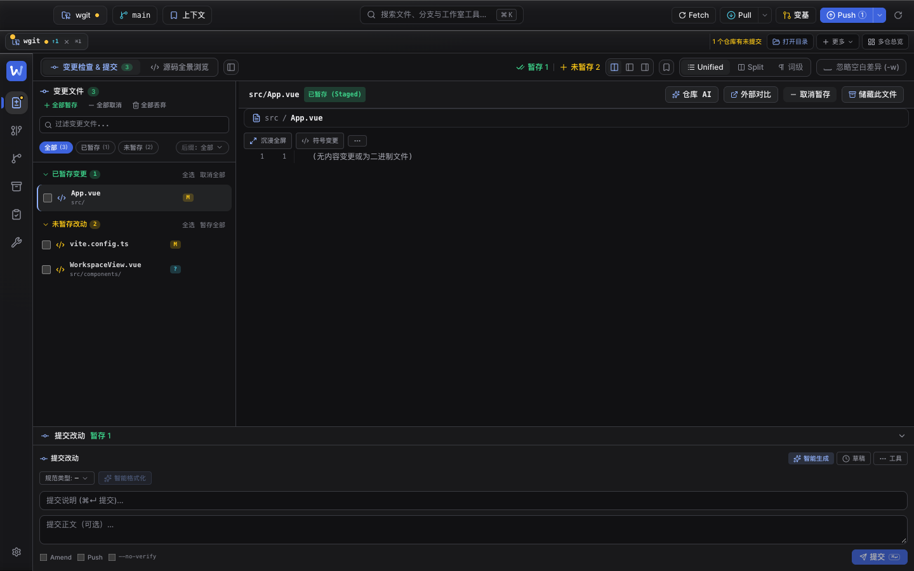
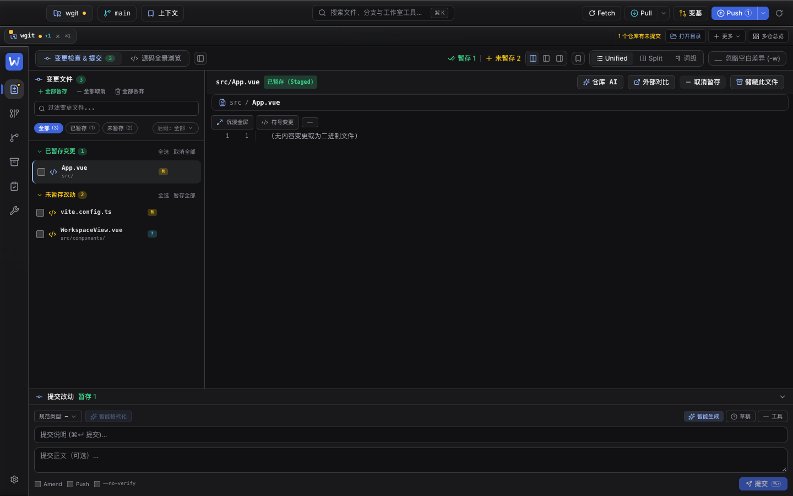
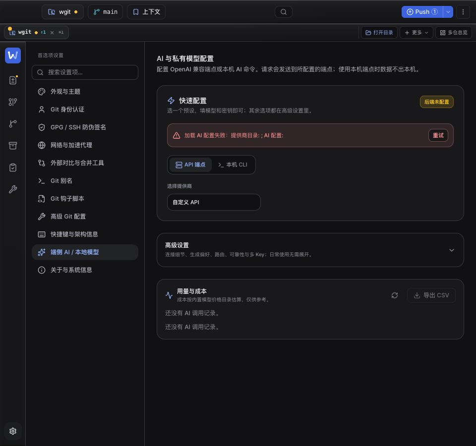
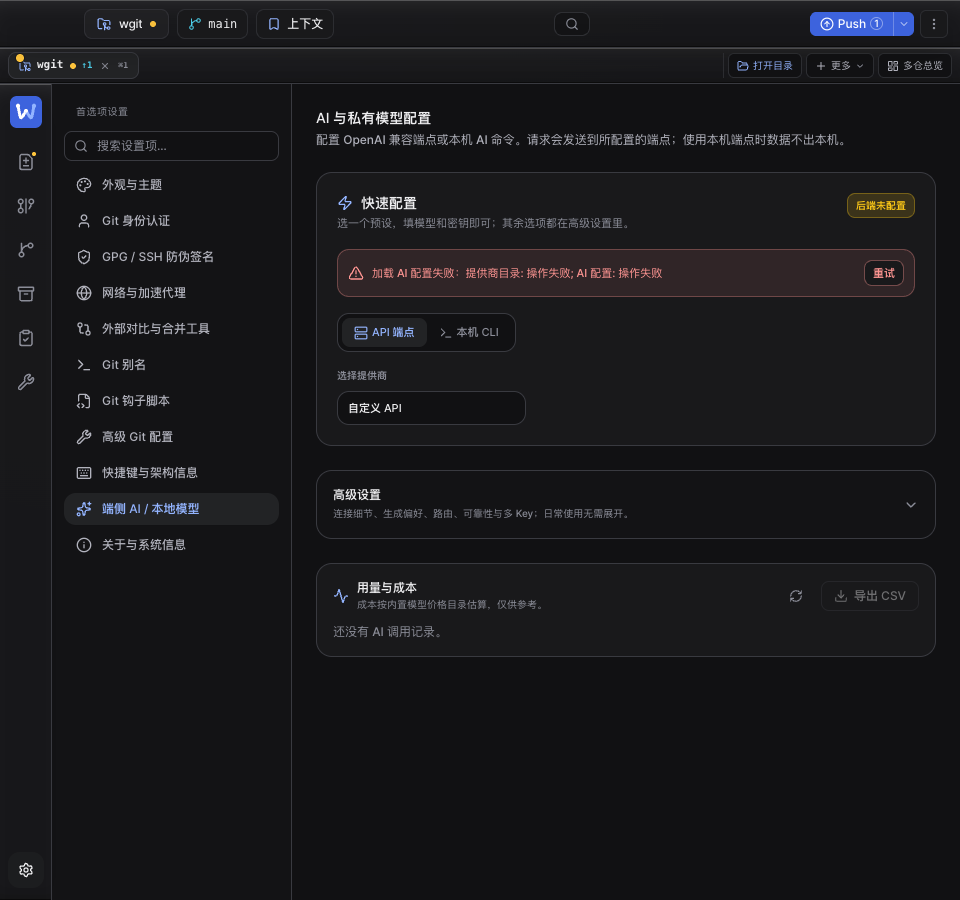
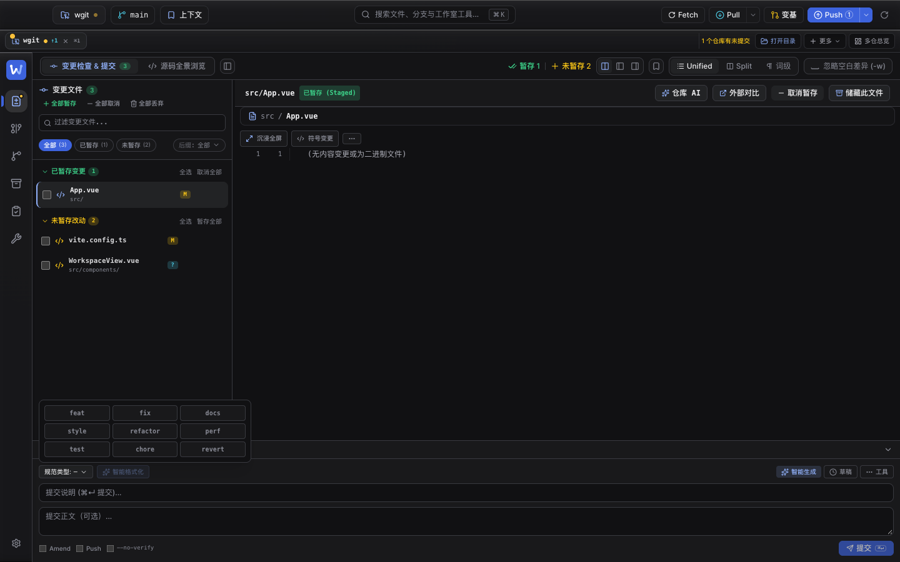
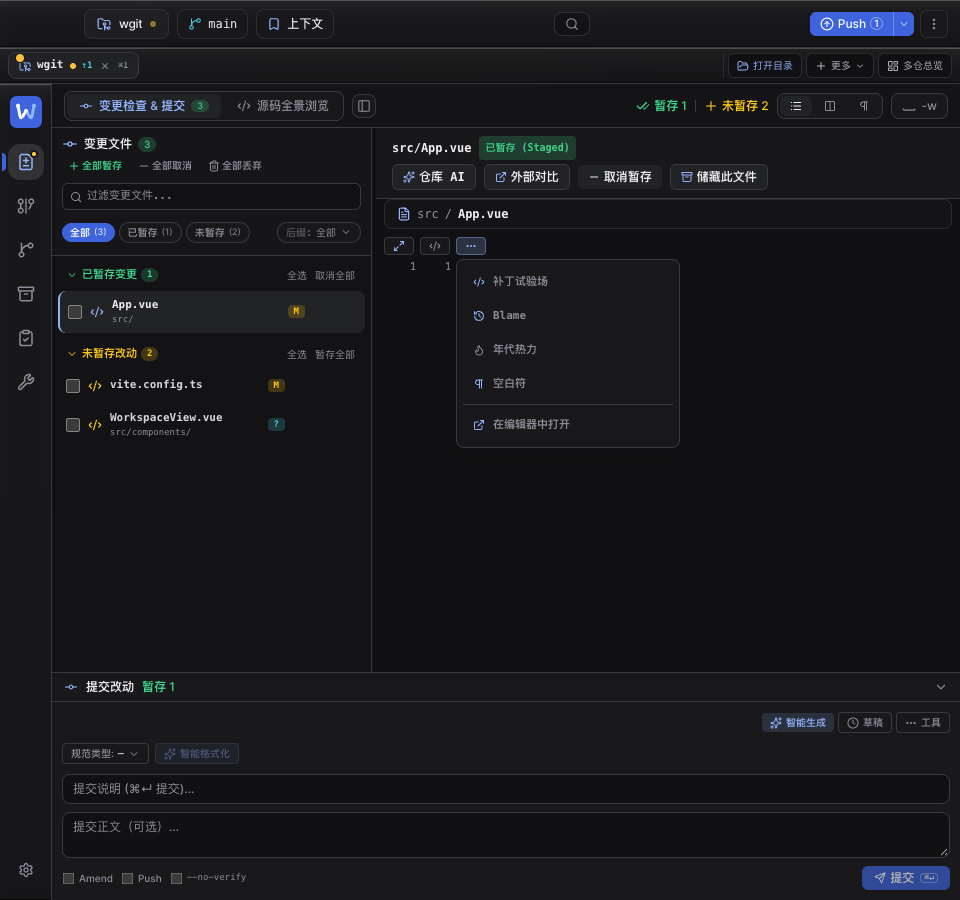
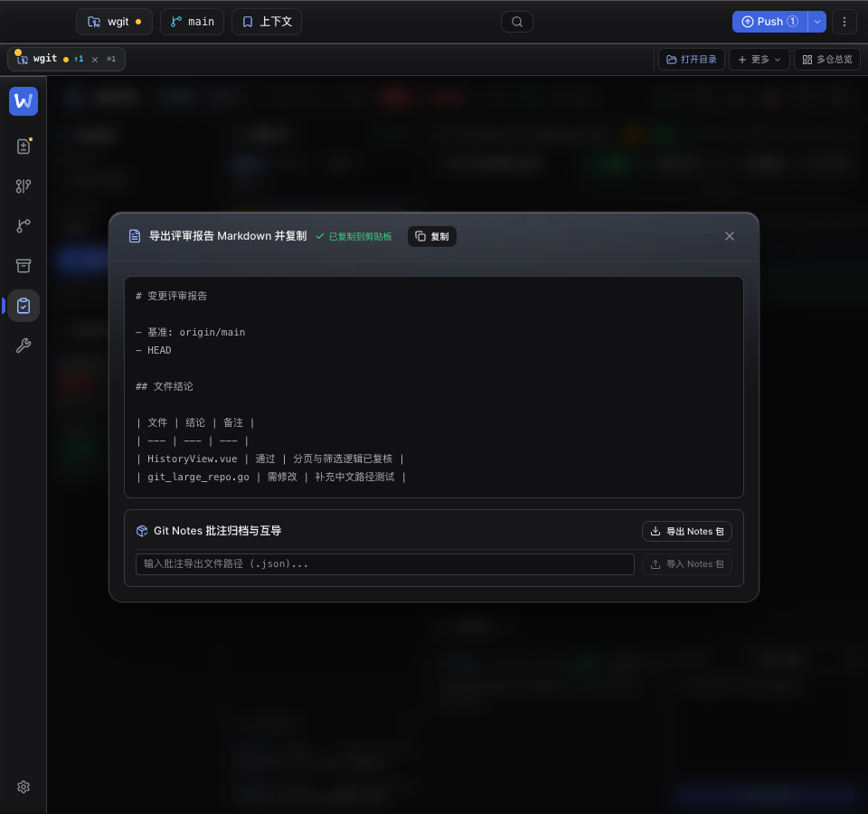
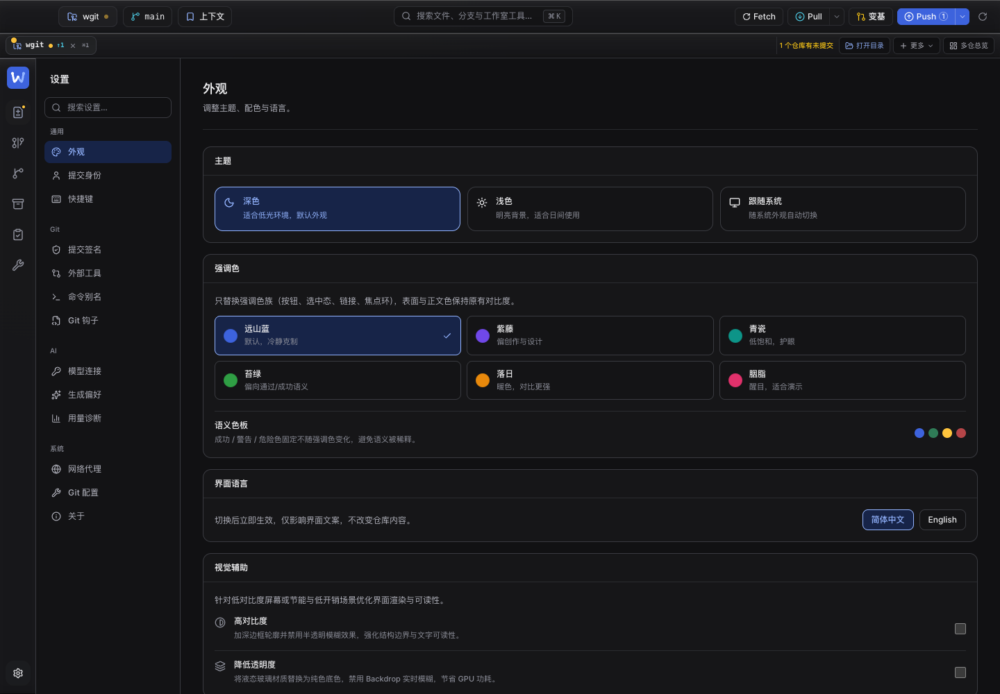
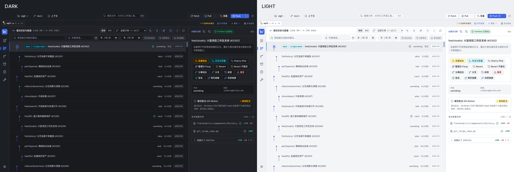

# 全局 UI 布局审查（2026-10-31）

> 承接 2026-10-30 的两轮审查（见 [layout-audit-2026-10-30.md](layout-audit-2026-10-30.md)）。这两天工作区布局被大幅改动：提交区从「变更栏底部」迁到**窗口底部的全宽固定条**（`composer-pin-bar`），源码树默认收起，差异工具栏收成「沉浸全屏 / 符号变更 / ⋯」，并新增仓库 AI、AI 配置/用量、评审导出、局域网评审等界面。
>
> 本轮按新布局重新审查，重点看**旧宽度假设在新容器里是否还成立**。自动化检测（越界、裁切、标签折行、弹层可点击性）在 960 / 1024 / 1280 / 1440 / 1920 与中英文下都没有再报错；下面 6 项是「能看见但明显不合理」的问题。

## 问题与修复

| # | 位置 | 现象（实测） | 根因 | 修复 |
| --- | --- | --- | --- | --- |
| 1 | 工作区 · 提交固定条 | 展开时连续出现两行「提交改动」：pin bar 一行、`CommitComposer` 自己的标题又一行；标题行与「规范类型」行又各占一行 | 提交区从窄栏迁到底部固定条后，pin bar 已负责标题/暂存数/折叠，组件内标题没有随之删除 | 删除组件内重复标题（保留 `role="region"` + `aria-label` 作为无障碍名称），并把「规范类型 / 智能格式化」与「智能生成 / 草稿 / 工具」合并为一行：底部条少 1 行（约 30px），差异区多出同等高度 |
| 2 | 提交条 · 三个下拉菜单 | 类型菜单横跨整个窗口：1920 下宽 **1852px**，9 个类型每格约 617px；草稿/工具菜单同样 1852px 宽，每行一条 | 菜单仍是窄栏时代的 `absolute left-2 right-2`（相对全宽提交条定位） | 每个菜单锚定到自己的触发按钮（`data-composer-menu-root` 加 `relative`）；类型菜单 `w-[340px]`、草稿 `w-80`、工具 `w-60`，并加 `max-w-[calc(100vw-32px)]` 兜底 |
| 3 | 工作区 · 差异工具栏「⋯」菜单 | 菜单向左越过差异栏边界，被分栏拖拽条与变更栏盖住；三个探测点有两个命中菜单外元素 | 菜单 `right-0` 从靠近左端的按钮向左展开，横跨到相邻面板；`@container` 使工具栏自成层叠上下文，`z-30` 无法越过分栏条 | 两个下拉（符号 / 更多）改为 `left-0` 向右展开，完全落在差异栏内；工具栏补 `relative z-20` 确保菜单压住下方差异内容 |
| 4 | 评审 · 导出报告弹窗 | 弹窗面板 `scrollWidth 738 > clientWidth 718`，右侧 20px（含纵向滚动条）被面板 `overflow-hidden` 裁掉 | `body-class="-mx-5 -my-4 p-0"` 想用负外边距抵消 UiModal 的 `px-5 py-4`，但 `p-0` 并不会覆盖 `px-5`（实测 padding 仍为 16/20px），负边距把滚动盒撑出面板 | UiModal 新增 `flushBody` 变体：真正不渲染 `px-5 py-4`；导出弹窗改用 `flush-body`，面板 `scrollWidth == clientWidth` |
| 5 | 设置 · AI 用量与成本 | 空状态「还没有 AI 调用记录。」连续出现两次（实测两个 `
`，y=624 / 652） | 两条 `v-if` 链：`!usage` 一条、`usage && usage.calls` 的 `v-else` 一条，`usage == null` 时两条都命中 | 第二条改为 `v-else-if="usage"`，只在「有记录对象但 0 次调用」时显示 |
| 6 | 设置 · 快速配置错误条 | 显示「加载 AI 配置失败：提供商目录：; AI 配置：」，冒号后为空 | `errorText()` 对空 message / `[object Object]` 直接 `String(err)`，拼出空占位 | 空消息回退为「操作失败 / Something went wrong」，有消息时原样显示 |

### 截图对照

| 提交条重复标题（修复前，1440） | 修复后（单一标题 + 单行工具栏） |
| --- | --- |
|  |  |

| AI 用量重复空状态 + 空错误占位（修复前） | 修复后 |
| --- | --- |
|  |  |

| 类型菜单（修复后，1440：340px，锚定触发器） | 差异「⋯」菜单（修复后，960：落在差异栏内） |
| --- | --- |
|  |  |

| 评审导出弹窗（修复后，滚动盒不再溢出面板） |
| --- |
|  |

## 守卫

- **单元**（`frontend/tests/shellLayout.test.ts`，本轮 +6 条）：提交条不再重复标题；三个菜单锚定触发器且宽度受限（禁止回退到 `left-2 right-2`）；差异工具栏两个菜单从左侧展开；AI 用量空状态只渲染一次；UiModal `flushBody` 契约与导出弹窗接线；AI 空错误回退。
- **浏览器**（`frontend/e2e/popovers.cjs`，已并入 `bun run audit`）：在原有顶栏 / 工具 / 草稿 / 历史菜单之外，新增 **提交类型菜单、提交工具菜单、变更后缀菜单、差异「⋯」菜单、评审导出弹窗**——逐个 `elementFromPoint` 验证可点击、标签不溢出、面板宽度不超过 320–420px、导出弹窗面板无横向溢出。

## 验证

| 项 | 结果 |
| --- | --- |
| `vue-tsc --noEmit` | 通过 |
| 前端单元测试 | **1652 pass / 0 fail**（148 文件；本轮 +6 条布局守卫） |
| `bun run audit` | 4 项浏览器审计全部通过（smoke / contrast / responsive / popovers） |
| `bun run shots` + `shots:check` | 16 张视觉基线按新布局重拍，复核通过 |
| `vite build --mode production` | 通过 |
| `go build -o bin/wgit .` | 通过，二进制已内嵌新前端产物 |

## 备注

- 提交条现在是全宽底部固定条；**任何在其内部浮出的菜单都必须锚定到触发器并限制宽度**，不能再按「左侧 8px / 右侧 8px」铺满。这条已写进守卫。
- `@container`（布局包含）会建立层叠上下文，弹层即使 `z-50` 也会被后绘制的兄弟盖住；历史页与差异工具栏都踩过。给容器 `relative z-20` 可修，但**优先把菜单收回自己的面板内**，避免跨过分栏。
- 负外边距不是「取消 padding」的正确方式：Tailwind 的 `p-0` 与 `px-5` 是不同属性，级联顺序不保证覆盖。需要全出血时用组件变体（本轮 `flushBody`），不要用 `-mx-*` 抵消。

## 补充修复：容器宽度、短窗口和数据态

继续用真实浏览器检查 960×640、1280×800 及 390 / 768 宽度，修复以下问题：

- **工作区**：变化列表与差异区改按扣除源码树后的实际宽度决定是否分栏。960px 窗口展开源码树时，原先约 270px 的差异列改为与变更列表切换；小于 600px 的工作区中源码树作为可关闭的浮层显示。窄工具栏保留带名称的图标入口。提交正文拖高受到视口高度限制，避免把差异区挤没。
- **顶栏**：窄屏移除桌面交通灯预留空间，收起工作上下文文字；三个下拉菜单在小屏贴合视口。浏览器守卫直接检查可见按钮边界，避免应用的 `overflow-hidden` 掩盖被裁切的操作。
- **设置与工具箱**：设置搜索结果和类别栏可独立滚动，小屏限制导航所占高度；切换设置或工具时回到内容顶部。工具箱在窄屏使用带名称与提示的图标操作，防止英文按钮挤掉整个标签栏。
- **本地评审**：备注与状态操作按详情列宽度重排，960px 英文界面中的备注框由约 94px 扩至 468px。评论元信息允许换行；窄列下评论表单放到列表下方，评论面板随窗口高度调整。
- **储藏与远端 PR**：储藏标题与操作允许分行；PR 的长账号截断、动作组整体换行，详情正文在剩余高度内滚动。
- **共享弹窗**：顶部搜索弹层扣除顶部偏移后限制高度，960×400 / 540 / 640 下保留底部 16px。快捷键清单恢复 672px 宽，只保留一处标题和关闭按钮、一个正文滚动区。

回归验证：

- 类型检查与生产前端构建通过；全量单测 **1655 pass / 0 fail**。
- smoke、中英文检查、深浅主题对比度、响应布局和浮层审计通过。新增设置/工具布局检查已接入 `bun run audit`；4 张交互状态视觉基线检查通过，无需重拍。
- `bun run audit:content-layout` 在开发服务器中注入浏览器内存样例，覆盖 960 / 1280 宽度 × 中英文的有数据评审、储藏、长账号 PR；不写入实际仓库。该检查需要 Vite 开发服务器，未接入支持生产预览的通用审计入口。
- Go 桌面构建通过。构建仍会输出本机工具链的 macOS 最低链接版本提示。

## 设置模块：短标题与统一结构

将入口统一为「设置」，按通用、Git、AI、系统四组组织 13 个页面。中文导航名称以 2–4 个字为主，页标题只表达当前功能；协议名、范围和使用步骤留在说明或字段标签里。

- 设置页面统一使用 `SettingsPageHeader`；卡片统一使用 `SettingsCard`，页标题与卡片标题保持明确的二级、三级层次。
- 导航与搜索拆为 `SettingsNav` 和 `SettingsSearch`，右侧使用可用宽度；长搜索结果与分类共用可滚动区域，跳转后当前分类保持可见。
- 外观按主题、强调色、语言和视觉辅助分卡；提交身份、签名、代理、外部工具、别名、钩子、Git 配置、快捷键和关于页使用相同间距与表单结构。
- AI 分为模型连接、生成偏好、用量诊断三页，分别管理连接与密钥、生成与路由、用量与迁移。旧 `localai` 跳转仍指向模型连接；设置搜索能直接定位到新页面，当前页面可恢复。
- 连接页补齐深度生成测试、密钥清除、Azure 版本与 CLI 环境设置；保存时保留其他页面更新的生成偏好。深度测试同时显示后端错误摘要和详细原因。
- 快速配置向导复用同一连接表单。三个旧 AI 页面在备份与迁移测试后移除，避免保留两套保存和状态逻辑。
- 浏览器覆盖 13 页 × 中英文 × 390 / 960 / 1280 宽度，检查单一页标题、标题单行、内容边界和当前导航状态；保存、清除、搜索、切换和 AI 全流程有独立回归。

整合后全量前端测试 **1704 pass / 0 fail**；生产构建、Go 构建、5 项浏览器审计与 macOS 应用包签名检查均通过。
AI 全流程连续两轮通过；仅更新设置页与共享向导的两张预期视觉基线，问答、评审和发布说明三张基线保持不变。

## 全局主题：中性工作台

重构原有 Liquid Glass 视觉体系，统一为克制的中性工作台。深浅主题共用布局与层级规则，强调色只用于选中状态和关键操作，Git 状态保留语义色。

- 顶栏、仓库栏、侧栏和阅读区域使用实色；移除多色背景、渐变、光晕及跟随指针的照明。
- 统一 chrome、内容、内嵌和选中表面令牌，以及边框、圆角、按钮、分段操作和浮层阴影。
- 仅菜单、弹窗等浮层使用高不透明度的中性材质与单层 12px 模糊；降低透明度、高对比度和强制颜色模式均有明确降级。
- 修复浅色语义标签的文字对比度、代码高亮规则互相覆盖，以及普通内容卡片误用警告底色的问题。
- 同步在线设计规范、启动背景与 macOS 窗口底色，并移除旧的动态玻璃照明逻辑。

验证：全量前端单测 **1703 pass / 0 fail**，生产前端与 Go 构建通过；6 项浏览器审计通过。覆盖深浅主题 × 6 种强调色，36 项真实截图像素对比度检查最低 **5.09:1**。16 张主题与交互状态视觉基线已更新并复核；macOS 应用包签名检查通过。

AI 全流程通过；模型连接、快速配置、问答、审查和发布说明 5 张截图逐张复核后更新，并再次以普通比较模式通过全部新基线。

