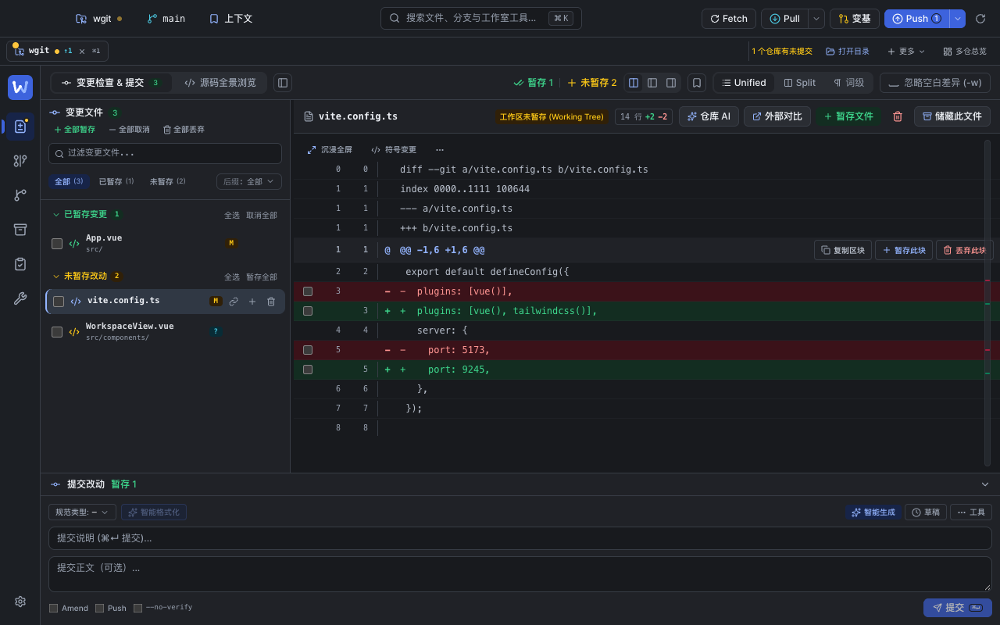
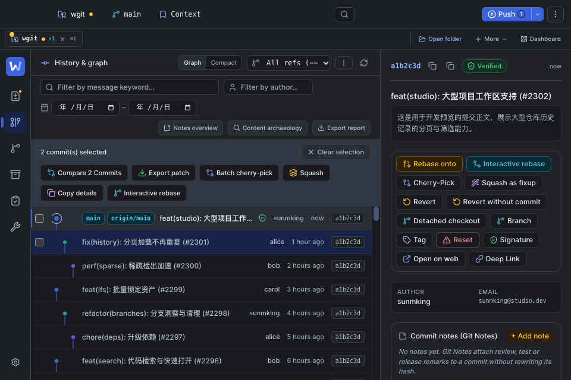
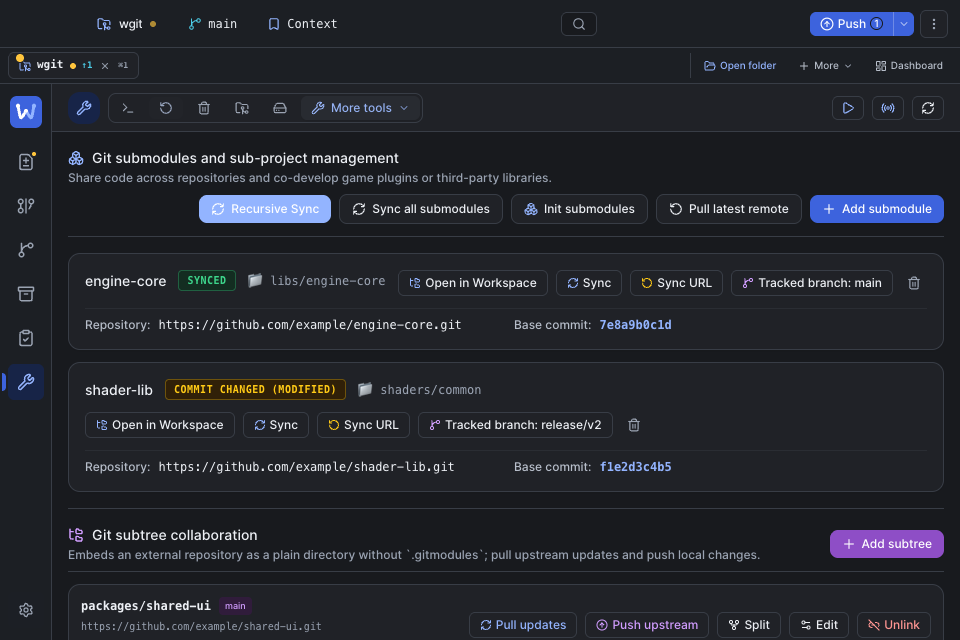

# 全局布局复核（2026-11-01）

承接中性工作台主题重构，使用真实浏览器检查深浅主题、中英文、390 / 960 / 1280 / 1440 宽度，以及 400px 高的短窗口。重点覆盖有数据、长引用、多选、后台任务和浮层状态，不只检查整页是否横向溢出。

## 工作区和侧栏

- 文件路径原先连续出现在操作栏和独立面包屑卡片中，现合并为一处。操作栏移出代码滚动层；长代码曾将操作按钮推到 x=6874px，现在横向滚动只影响代码，文件操作始终留在面板内。
- 次要文件操作按实际差异列宽度收为带完整名称的图标，按钮组整体重排；文件名截断时保留完整悬停标题。移除提交区固定后不再需要的大块底部留白。
- 代码块操作紧贴阅读区右侧，窄列使用具备完整名称的图标，避免复制、暂存和丢弃按钮随长代码一起移出窗口。
- 差异缩略图原先相对整个窗口定位，覆盖工具栏和提交字段。现在测量真实阅读视口，跟随分栏、提交区折叠和窗口尺寸变化，导航点击保留；嵌入弹窗时转换到弹窗的定位坐标，避免再次偏移或被裁切。
- 短窗口下主导航和后台任务分别滚动，设置入口固定可见；即使同时有四个任务，也不会被挤到窗口外。

## 历史和分支

- 多选工具栏的七个操作曾溢出图谱列，按钮文字堆叠成多行。现在保持按钮文字单行，整组按宽度换行，清除选择有独立位置；移除无冲突时误显示的冲突提示。
- 历史行高由 56px 调为 40px，图谱、虚拟滚动、键盘定位使用同一行高。长提交标题仍保持单行，减少窄窗口里的无效留白。
- 本地与远程长分支名、上游引用限定在名称区域，单行截断并保留完整标题，避免一条记录膨胀到 120–145px。

## 设置和工具

- 设置搜索从分类滚动区中分离；切换到底部分类后仍然可见，搜索结果独立滚动，键盘选中项会自动进入视口。
- 子模块标题和操作区按容器宽度换行，名称与路径不再被动作挤压。960px 英文界面中，标题可用宽度从 119px 增至 876px，头部高度从 174px 降至 88px。
- 远端卡片把八个动作放到独立行，URL 可用宽度从 142px 增至 402px，保留所有操作。
- LFS 空状态横跨完整网格；Reflog 标题和说明分行，避免并排挤成碎列。

## 同步和变基弹窗

- 长分支与上游引用使用受限单行并保留完整标题。同步弹窗头部从 171px 降至 84px，960×400 下正文从 85px 增至 172px；390px 下头部横向溢出从 104px 降至 0。
- 变基概览和建议项正确分配宽度，底部动作组整体换行，按钮名称保持单行。
- 全局通知测量自身高度，为弹窗预留独立空间，避免覆盖确认按钮。多条长错误最多占视口高度的 30%，可以滚动；新通知进入后定位到首行，关闭、撤销和悬停暂停行为保留。清空通知后恢复原有弹窗大小与位置。

## 回归守卫

- 新增 `audit:workspace-layout`：中英文 × 三种窗口，覆盖长代码横向滚动、文件操作命中、缩略图边界与导航、提交区折叠，以及四个任务下的短窗口导航；补充真实分支比较弹窗里的缩略图滚动、缩放和关闭重开检查。
- 扩展内容布局审计：覆盖七个批量动作、长分支、长中英文提交标题，并在 45 次键盘导航后验证虚拟行与图谱仍精确对齐。
- 设置布局审计增加固定搜索与选中结果可见性检查；新增同步/变基弹窗布局审计并接入总审计。
- 通知专项检查覆盖命令面板、快速打开、快捷键、同步、变基和确认框，在 960×400 与 390×640 下验证通知首行、撤销、暂停、操作命中及清空后的布局恢复。

## 验证结果

- 全量前端单测：**1706 pass / 0 fail**（154 个文件）。
- 类型检查、生产前端构建、Go 桌面与服务端构建均通过。
- 7 项通用浏览器审计全部通过；工作区、内容布局和通知专项检查通过。
- 16 张普通主题和交互状态视觉基线逐张复核后更新，普通比较模式通过。
- AI 全流程与 5 张视觉基线比较通过；仅快速配置弹窗因通知避让更新预期截图，其余 4 张基线保持不变。
- macOS 应用已重新打包，严格签名校验通过。
